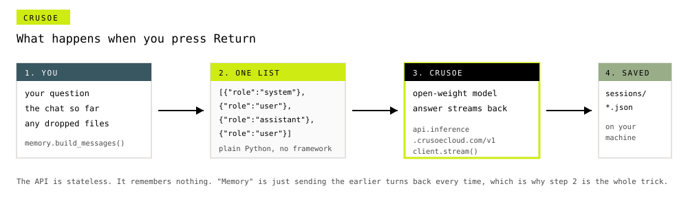

<div align="center">



# Crusoe Chat

**A small chatbot that runs on your laptop and talks to open models on Crusoe.**

Pick a model. Ask anything. Drop in a document. Come back to any earlier conversation.

</div>

---

## What it is

An everyday chatbot, like the ones you already use, with three differences:

- **It runs on Crusoe.** Open-weight models, your API key, billed per token.
- **It runs on your machine.** Conversations are saved as plain JSON files in a folder you can open. Nothing is sent anywhere except your messages to Crusoe.
- **You can read all of it.** The whole thing is five short files, none longer than a page.

Use it in place of your usual chatbot for a week and you will have a real feel for what inference on Crusoe is like.

---

## Before you start

You need one thing: **a Crusoe API key.**

Get it at [console.crusoecloud.com](https://console.crusoecloud.com) → **Intelligence Foundry** → **API Keys** → **Create key**. Copy it somewhere you can paste from.

That is the only thing you will ever be asked for.

---

## Setup, once

Open **Terminal** (press `Cmd + Space`, type `Terminal`, press Return). Paste these three lines, one at a time, pressing Return after each:

```bash
git clone https://github.com/<org>/crusoe-chat.git
cd crusoe-chat
./setup.sh
```

The first line downloads this project into a new folder called `crusoe-chat`. The second moves you into that folder. The third installs everything and asks for your API key.

About two minutes. It installs a private copy of Python inside the project folder and changes nothing else on your machine.

---

## Using it

```bash
./chat.sh
```

That opens the chatbot in your browser. Press `Control-C` in the Terminal window to stop it.

| In the app | What it does |
| --- | --- |
| **Model** | Every model Crusoe serves. Switch mid-conversation. |
| **New chat** | Start fresh |
| **Earlier chats** | Everything you have asked before, newest first. Click to reopen. |
| **Instructions for the assistant** | Change how it behaves. "Reply only in bullet points", "You are a Python tutor". |
| **The message box** | Type, or drag a file straight in |

Supported files: `.pdf`, `.docx`, `.txt`, `.md`, `.csv`, `.json`, `.yaml`, and most code and log files.

---

## Seeing how it works

```bash
./notebook.sh
```

Eight short steps, about ten minutes, showing the actual API calls the chatbot makes:

1. The client, and the one line that makes it Crusoe
2. Your first call
3. Streaming
4. Which models you can call
5. **Memory** — watch the model forget, then see the one-line fix
6. The same thing with LangChain, for comparison
7. Documents, with no database and no embeddings
8. How those map onto the five files

Step 5 is the one worth your time. It is the thing most people get wrong about how chatbots work.

---

## The code

```
app.py                     The browser interface, and nothing else

crusoe_chat/
  config.py                Your API key, the base URL, the default model
  client.py                Three thin wrappers over the OpenAI client
  memory.py                Building the message list, and keeping it to a size
  sessions.py              Saved conversations, one JSON file each
  documents.py             Turning a dropped file into text

notebook.ipynb             The eight steps above
scripts/check_setup.py     Confirms your key works and Crusoe is reachable
sessions/                  Your conversations. Plain JSON. Delete any time.
tests/                     Proof the pieces hold up
```

**The one thing to understand:** the API has no memory. It forgets you between calls. A chatbot "remembers" only because it re-sends the earlier turns with every new question. That is `memory.py`, and it is about forty lines.

### Changing it

Open `crusoe_chat/config.py`:

```python
DEFAULT_MODEL = "openai/gpt-oss-120b"
DEFAULT_SYSTEM_PROMPT = "You are a helpful assistant running on Crusoe..."
```

Edit, save, restart. That is the whole customisation story.

---

## Your API key and your data

- `setup.sh` asks once and saves it to `.env` in the project folder.
- `.env` and `sessions/` are both in `.gitignore`, so neither is ever committed.
- If the key is missing, the app and the notebook ask you for it.
- To change keys, delete `.env` and run `./setup.sh` again.

Your messages go to Crusoe's API. Nothing else leaves the folder, and the app sends no telemetry.
